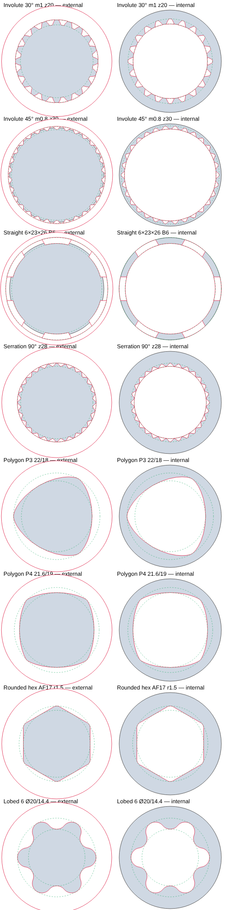

# Splines for SolidCraft

A [SolidCraft](https://solidcraft.io) command plugin that cuts a spline onto a shaft (external) or into a
hub or bore (internal). It draws the profile in an ordinary sketch and cuts it with ordinary extrudes, so
the result is plain, editable SolidCraft history: sketches and *Extrude (cut)* features in the timeline.



## Profile types

| Type | Inputs | Notes |
|---|---|---|
| **Involute** | teeth, module, pressure angle (30 / 37.5 / 45°), profile shift | Flat-root diameters per ISO 4156 / ANSI B92.2M (for example, 30° external: major m(z+1), minor m(z−1.5)). Override them with *Major* / *Minor diameter*. The profile shift x moves the diameters by 2xm and the tooth thickness by 2xm·tan α, in the DIN 5480 manner. Flanks are fit-point splines through exact involute points, with a radial line below the base circle. |
| **Straight-sided** | splines N, minor d, major D, width B | ISO 14 style, for example 6 × 23 × 26 with B = 6. |
| **Serration** | teeth, major, minor, flank angle | Straight flanks. Tooth = space at the mean diameter. A space whose flanks meet above the root ends in a sharp V. |
| **Polygon (P-profile)** | sides (3, 4…), major, minor | The harmonic P3G / P4C-style curve with mean diameter (D+d)/2 and eccentricity (D−d)/4. Profiles that would not be convex are refused. |
| **Rounded polygon** | sides, across flats (minor), corner radius | Square, hex and similar drives. You can give the across-corners size as *Major* instead. |
| **Lobed / hexalobular** | lobes, major (tips), minor (valleys), lobe radius | Lobe and valley arcs are tangent. A lobe radius of 0 picks one so that the two radii come out about equal. |

**Clearance:** for tooth forms, clearance is the total side clearance at the pitch circle. External teeth get thinner by half of it and internal spaces get wider by half. The internal major diameter also grows by it for straight-sided splines and serrations. For outlines, clearance is applied on the diameter. A hub and shaft made with the same settings and clearance *c* fit together with that clearance.

## How it cuts

- **External:** first a ring is cut from the major diameter outward, which turns the shaft down to the major diameter. This step is skipped when the selected shaft is already that size. Then one closed loop per tooth space is cut, from the root up to just past the major diameter.
- **Internal:** first the minor-diameter bore is cut. This step is skipped when the selected bore is already at least that size. Then one loop per space is cut, out to the root (major) diameter.
- **Outline types:** these are cut in one step. External cuts the ring between the outline and a circle outside the part; internal cuts the outline itself.

The sketch is placed 0.5 mm outside the start face, and the cut runs *Length* + 0.5 mm into the material (or through all when *Length* is 0). This avoids a sketch that coincides with the face. Only the selected body is cut. With more than about 230 curves (many teeth), one space is drawn and repeated with a sketch circular pattern, because a plugin run may make at most 256 host calls.

## Using it

1. In SolidCraft (desktop), open **Preferences › Plugins › Install plugin…** and choose `dist/spline.zip`. The plugin asks for no file, design, app or plugin permissions. It only uses sketch, extrude and read-only query commands.
2. Select where the spline starts. You can select any one of these:
   - a **circular edge** at the shaft end or bore rim (recommended);
   - a **cylindrical face** together with the **flat face** where the spline starts;
   - a **flat end face** (the spline is centred on the face's centroid).
3. Choose **Model › Splines › create**, fill in the form and click **Run**. The whole spline is one undo step.

The plugin works out which side of the start face the material is on from the body's bounding box (or the face normal). Tick *Flip direction* if it guesses wrong. To place a spline without a selection, for example from a script, fill in *Center* (`x, y, z`), *Axis* (`X`, `-Z` or `x, y, z`) and optionally *Body*.

The read-only **dimensions** entry returns the computed diameters and tooth thickness without changing the design.

From a script or MCP, use `plugin.run` with entry `spline.create`, for example:

```json
{"type": "involute", "gender": "external", "teeth": 24, "module": 1.25, "pressure_angle": 30, "length": 30, "clearance": 0.05}
```

The reply lists the sizes used (major, minor, pitch and base diameters, tooth thickness), the feature names and the placement.

## Building

```bash
cargo install wasm-tools --locked
```

```bash
./build.sh
```

The script runs the tests, builds the `wasm32-unknown-unknown` module (the toolchain is pinned in `rust-toolchain.toml`), wraps it as a WebAssembly component with `wasm-tools component new` (no WASI), writes `package/spline/plugin.json` with `tools/manifest.py`, and zips the result to `dist/spline.zip`.

`cargo run --example preview -- out.svg` draws every profile type, as in the picture above.

## Layout

- `src/geom.rs`: profile math and its tests.
- `src/place.rs`: placement from the selection.
- `src/lib.rs`: parameters, the command sequence, and the WIT glue for wasm.
- `tests/host.rs`: the `create` entry run against a recording fake host.
- `wit/plugin.wit`: SolidCraft's `craft:plugin@0.1.0` interface (`commands@0.1`).

## Limits

- Involute roots are flat (a circular arc at the minor diameter) with a sharp corner. There is no root fillet. Add one afterwards with *Fillet* if you need it.
- The geometry is generated once. Changing a parameter means undoing and running the plugin again, because SolidCraft does not replay plugins on parameter changes yet.
- The sizes follow common standards, but check critical fits against the standard you are working to.
